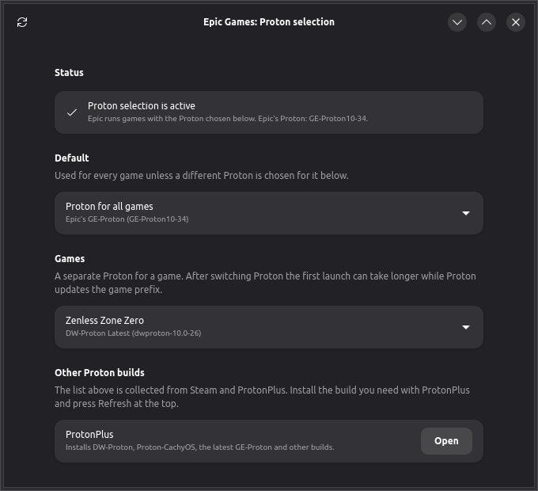

# Epic Games Launcher for Fedora (egl-fedora)

An unofficial RPM of the Epic Games Launcher for Fedora. This project is not
affiliated with or endorsed by Epic Games. The Epic Games Launcher and the EOS
SDK inside the package remain proprietary Epic Games software.



## What you get

- **Epic Games Launcher in your app menu.** It is taken from the official
  AppImage and runs on the system WebKitGTK 4.1, GTK 3 and libsoup 3, natively
  on Wayland.
- **Automatic updates.** Once an hour the system checks the latest release of
  this repository and installs a newer version by itself. You don't need to do
  anything.
- **Proton selection.** The "Epic Games: Proton selection" window opens right
  from the Epic tray icon. In it you choose which Proton runs your games: the
  GE-Proton that Epic downloads itself, DW-Proton, Proton-CachyOS, Proton from
  Steam and others. You can set one Proton for all games or a separate one for
  each game.

The Proton selection window and notifications follow the system language:
English, or Russian on a Russian locale.

## Installation

1. Download `epic-games-launcher-*.x86_64.rpm` from the latest
   [release](https://github.com/DXVSI/egl-fedora/releases/latest).
2. Install it with a double click or with:

   ```sh
   sudo dnf install ./epic-games-launcher-*.x86_64.rpm
   ```

3. Open Epic Games Launcher from the app menu and sign in.

## Choosing Proton

The "Epic Games: Proton selection" window opens in three ways:

- "Choose Proton for games" in the Epic tray menu (the first item);
- right-click the Epic Games Launcher entry in the app menu, then
  "Choose Proton";
- the "Choose Proton" button in a notification. It appears the first time each
  game starts and says which Proton the game is running on. If you have already
  chosen a Proton for that game, there is no notification.

The window has no entry of its own in the app menu, so it is not confused with
the launcher itself.

The tray item appears when Epic is started from the app menu or through a
`com.epicgames.launcher://` link. If Epic is set to start with the system, it
starts directly and the tray item is missing. In that case open the window by
right-clicking the Epic entry.

In the window:

- "Default" sets the Proton for all games.
- The "Games" section lets you choose a separate Proton for any installed game.
- Newer Proton builds (DW-Proton, Proton-CachyOS, the latest GE-Proton) are
  easiest to install with
  [ProtonPlus](https://flathub.org/apps/com.vysp3r.ProtonPlus). Then press
  Refresh in the window.

Selection works once Epic has downloaded its own Proton: launching any Windows
game once is enough. If the chosen Proton is removed, the game runs on Epic's
Proton.

How it works: Epic launches games with the `proton` file in its directory
`~/.local/share/com.epicgames.eglv2/compat/runtime/<version>/`. The package
replaces this file with a small stub and keeps the original next to it as
`proton.epic`. The stub reads `~/.config/egl-fedora/proton.conf` and runs the
chosen Proton. For DW-Proton, GE-Proton and other builds with protonfixes it
also passes the game ID, so the fixes for that particular game apply. Launch
log: `~/.local/state/egl-fedora/proton.log`.

The tray item is added by a small `libayatana-appindicator3.so.1` in
`/usr/lib64/egl-fedora/tray/`. The Epic app menu entry puts this directory
first in `LD_LIBRARY_PATH`, the launcher loads its tray library from there,
and the library adds the item to the menu and passes everything else to the
real system library. The Epic binary itself is not modified.

## Updates

Check manually:

```sh
sudo /usr/libexec/egl-fedora/egl-update --check
```

Turn off automatic updates:

```sh
sudo systemctl disable --now egl-fedora-update.timer
```

The launcher's built-in self-update does not work in an RPM install: Epic
supports it only for .deb and AppImage. New versions come through this
repository.

## Uninstall

```sh
sudo dnf remove epic-games-launcher
```

Your games and Epic settings stay in `~/.local/share/com.epicgames.eglv2`.
After the package is removed, games run on Epic's Proton.

## Building

You need Fedora, `rpm-build`, `squashfs-tools`, `cargo`, `gcc`, `gtk3-devel`,
`gtk4-devel`, `libadwaita-devel`, `libayatana-appindicator-gtk3`, `patchelf`,
`desktop-file-utils`, `jq` and `curl`.

```sh
packaging/scripts/build-rpm.sh build
```

The script downloads the official AppImage of the current stable version and
builds a source archive with vendored crates and the RPM in
`build/RPMS/x86_64/`.

The Proton script tests run in `%check`. The tray item is tested separately on
a running desktop: `tests/tray-shim-check.sh`.

## Releases

Releases are built by GitHub Actions (`.github/workflows/release.yml`). Every 4
hours it checks the Epic version. If there is no release yet for the pair
"Epic version + packaging revision", it builds the RPM, runs the tests,
installs the package on a clean Fedora and publishes a release with
`SHA256SUMS` and an attestation. Installed copies pick it up within an hour.

The packaging revision is stored in `packaging/RELEASE`. To release changes in
this repository without a new Epic version, increase it.

## License

The code in this repository is licensed under MIT, see [LICENSE](LICENSE).
